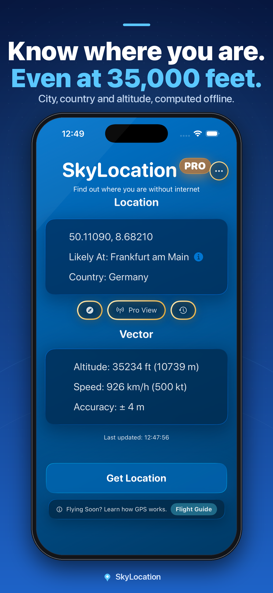
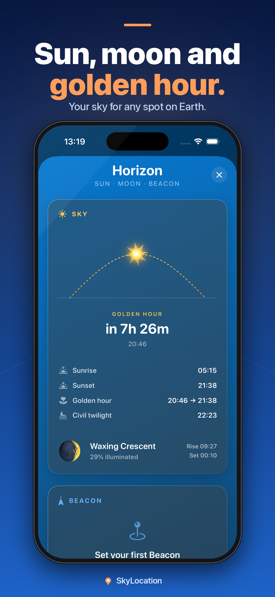
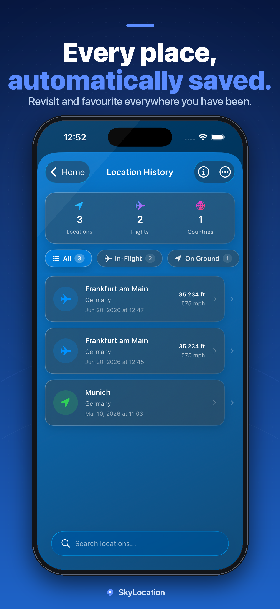

# SkyLocation

### Know exactly where you are. Even without signal.

**Offline GPS for iPhone, iPad and Android.** Your exact coordinates, nearest city, and country, in airplane mode, underground, at sea, or anywhere off the grid. A 160,000-place database lives inside the app, so there is nothing to download before you travel. Free, with an optional one-time **Pro** upgrade (€5.99 in Germany, $4.99 in the US, prices vary by region).

**[⬇️ App Store](https://apps.apple.com/app/skylocation/id6751451868) · [▶️ Google Play](https://play.google.com/store/apps/details?id=com.skylocation.android) · [🌐 skylocation.app](https://www.skylocation.app) · [🐞 Report a bug / request a feature](https://github.com/onekapisch/skylocation/issues/new/choose)**

 

> [!NOTE]
> **SkyLocation is a commercial, closed-source app.** This repository hosts its **documentation, release notes, and public issue tracker**, not the source code. Bug reports and feature requests are genuinely welcome: [open an issue](https://github.com/onekapisch/skylocation/issues/new/choose).

---

## Why

Your phone's GPS chip is a **receiver**. It listens to satellites, so it keeps working with cellular and Wi-Fi switched off, in airplane mode, in a tunnel, on a ship, deep in the mountains. The problem is the apps: most map apps go blank the moment you lose signal, because they need a connection to turn your coordinates into a place.

SkyLocation closes that gap. It reads your raw GPS fix and resolves your **nearest city and country entirely on-device**, from a database that ships inside the app. No connection, no pre-trip downloads, no account. Open it at 37,000 ft, point at the window, tap once, and you know where you are.

## What you get

- 🛰️ **Coordinates anywhere, offline**: exact latitude/longitude, altitude, speed, and accuracy straight from GPS satellites, with the network off.
- 🏙️ **Nearest city & country, built in**: a **160,000-place** offline database turns raw numbers into a readable location. Nothing to download first.
- ✈️ **Flights** *(Pro)*: scan a boarding pass and follow the flight from your own GPS fixes, with travel-day reminders.
- 🌍 **Sky Passport and Globe Explorer** *(Pro)*: a 3D passport of the countries you have visited and a 3D globe to explore them.
- 🪪 **Location Pass** *(Pro)*: a frameless 3D pass of your position to save as a transparent PNG or share.
- 🔎 **Anywhere Lookup** *(Pro)*: search any city on Earth offline and get its coordinates in decimal, DMS, UTM and MGRS, plus distance and bearing.
- 📍 **Exact Place** *(Pro)*: pinpoint down to the village or suburb, not just the closest big city.
- 🌅 **Horizon** *(Pro)*: sunrise, sunset, golden hour, civil twilight, and moon phase, plus a live compass that points to your saved beacons. All computed offline.
- 🧭 **Insights** *(Pro)*: timezone, hemisphere, climate, elevation, distance from the equator, and live GPS precision at a glance.
- 🗂️ **Private location history** *(Pro)*: every detection auto-saved, searchable, and filterable (in-flight / on-ground / favorites). It never leaves your device.
- 🗺️ **Interactive maps** *(Pro, iPhone and iPad)*: standard, hybrid, and satellite views, plus one-tap open in Apple or Google Maps.
- 🆘 **Emergency SOS** *(Pro)*: share your exact position when it matters, built for off-grid moments.
- ✈️ **GPS Flight Guide** *(free)*: how to get a fix at altitude, and why GPS works when nothing else does.

## Available on

| Platform | Requirement | Get it |
|---|---|---|
| **iPhone and iPad** | iOS / iPadOS 18.6+ | [App Store](https://apps.apple.com/app/skylocation/id6751451868) |
| **Android** | Android 8.0+ | [Google Play](https://play.google.com/store/apps/details?id=com.skylocation.android) |

## How it compares

SkyLocation is built for one job: **instantly knowing exactly where you are when you have no signal**, especially in the air. These are all good apps in adjacent categories. Here is an honest look at that specific dimension. ✅ yes · ⚠️ partial / with setup · ❌ no.

| | **SkyLocation** | Apple Maps (offline) | Google Maps (offline) | Flighty | Organic Maps |
|---|:---:|:---:|:---:|:---:|:---:|
| Works with zero internet / in airplane mode | ✅ | ⚠️ in pre-downloaded areas | ⚠️ in pre-downloaded areas | ❌ needs internet | ✅ with downloaded maps |
| Nothing to download before you travel | ✅ database is built in | ❌ download regions first | ❌ download regions first | - | ❌ download maps first |
| Shows exact GPS coordinates | ✅ | ❌ | ❌ | ❌ | ✅ |
| Nearest city & country offline | ✅ 160k places | ⚠️ within download | ⚠️ within download | ❌ | ⚠️ |
| Designed for in-flight use | ✅ | ❌ | ❌ | ✅ flight tracking | ❌ |
| Private location history | ✅ on-device | ❌ | ⚠️ Timeline (account) | ⚠️ flights only | ❌ |
| No account required | ✅ | ✅ | ❌ | ❌ | ✅ |
| Price | **Free + €5.99 once** | Free | Free | Subscription | Free (open source) |

Different tools for different jobs: Flighty is excellent for **flight tracking**, Organic Maps and the offline modes of Apple/Google Maps are great for **navigation with pre-downloaded maps**. SkyLocation is the one that tells you your **precise position and place, instantly, with nothing pre-loaded**.

## Privacy & security

No account, no analytics and no tracking. Your coordinates and history are computed and stored **on your device** and are never uploaded. Purchases go through Apple or Google and the RevenueCat purchase service. Optional map tiles load from the internet. SkyLocation is **Built in Germany** and GDPR-ready. Full details, including what the marketing website does differently, are in **[SECURITY.md](SECURITY.md)**.

## Install

**iPhone**
1. Open the **[App Store listing](https://apps.apple.com/app/skylocation/id6751451868)** and tap *Get*.
2. Launch SkyLocation and allow **Location → While Using the App** (Precise on).
3. Tap **Get Location**. Requires iOS 18.6+. Updates ship via the App Store; to remove, long-press the icon → *Remove App*.

**Android**
1. Open the **[Google Play listing](https://play.google.com/store/apps/details?id=com.skylocation.android)** and tap *Install*.
2. Launch SkyLocation and allow the **location** permission.
3. Tap **Get Location**. Requires Android 8.0+. Updates ship via Google Play; to remove, long-press the icon → *Uninstall*.

No sign-up, and the core offline GPS, nearest city, and country are free on both platforms.

## Roadmap & feedback

We build from real requests. The public roadmap lives in **[Issues](https://github.com/onekapisch/skylocation/issues)**: open a [bug report](https://github.com/onekapisch/skylocation/issues/new/choose) or [feature request](https://github.com/onekapisch/skylocation/issues/new/choose), and 👍 the ones you want most. Release notes are in **[CHANGELOG.md](CHANGELOG.md)**.

## FAQ

**Is SkyLocation open source?**
No. It is a commercial app sold on the App Store and Google Play. This repository is its public documentation and issue tracker, not its source code.

**Why pay for Pro when free offline map apps exist?**
Free SkyLocation already gives you exact coordinates plus your nearest city and country offline, with zero setup. **Pro (€5.99 in Germany, one-time, no subscription, bought separately on each store)** adds *Flights*, the *Sky Passport*, pinpoint *Exact Place*, the *Horizon* sun/moon/compass, private *Location History*, interactive maps, *Emergency SOS* and more. If you want full offline turn-by-turn navigation, a maps app like Organic Maps is a great free choice. SkyLocation is for knowing *exactly where you are right now*, especially in the air.

**Does it really work in airplane mode with no signal?**
Yes. GPS is satellite-based and receive-only, so it works without cellular or Wi-Fi. Internet is only ever optional (for example, loading map tiles).

**Do you collect or upload my location?**
No. Your location is processed on-device and never uploaded. Only optional map tiles load from the internet. See [SECURITY.md](SECURITY.md).

---

**If SkyLocation helps you, please ⭐ [star this repo](https://github.com/onekapisch/skylocation). It genuinely helps an indie app get discovered.**

[App Store](https://apps.apple.com/app/skylocation/id6751451868) · [Google Play](https://play.google.com/store/apps/details?id=com.skylocation.android) · [Website](https://www.skylocation.app) · [Issues](https://github.com/onekapisch/skylocation/issues/new/choose) · [Privacy](SECURITY.md)

Offline GPS · in-flight GPS · GPS without internet · airplane-mode location · private location history · iPhone & Android. Built in Germany by Aeon GbR.

